<p align="center">
  
</p>

<h1 align="center">VetClinic</h1>

<p align="center">
  Veterinary clinic management desktop app · Veteriner klinik yönetim uygulaması<br>
  <b>Electron · SQLite · Windows / macOS · English / Türkçe</b>
</p>

<p align="center">
  <a href="#english">English</a> · <a href="#türkçe">Türkçe</a>
</p>

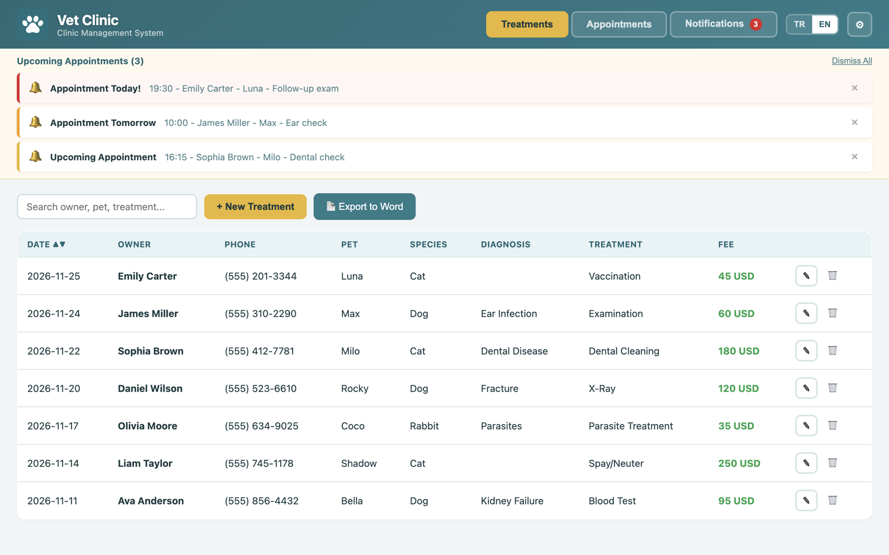

---

## English

VetClinic is a lightweight, offline desktop application for small veterinary clinics. It keeps treatment records, manages appointments, books follow-up visits automatically (vaccine boosters, parasite treatments, check-ups…), reminds you of upcoming appointments and sends reminder messages to pet owners over WhatsApp. All data is stored locally in a single SQLite file, and no account or internet connection is needed (except for WhatsApp).

The app is not tied to any particular clinic: the clinic name, currency and phone country code are set in **Settings**, and the whole interface can be switched between **English and Turkish** with one click.

### Features

| | |
|---|---|
| **Treatment records** | Owner, phone, pet, species, diagnosis, treatment, date and fee. Search across all fields, sort by date, owner name autocomplete (the phone number fills in automatically). |
| **Editable lists** | Treatment types and diagnoses are dropdowns you can extend or trim with the **+ / −** buttons. |
| **Appointments** | Pending, completed, cancelled and overdue status. Complete or cancel with one click, filter and sort by date. |
| **Auto appointment rules** | When a treatment matches a rule (e.g. *Rabies Vaccine → 180 days*), a follow-up appointment is booked automatically. Turned on or off with a switch in the treatment form. |
| **Notifications** | On launch, appointments for today, tomorrow and the next 3 days are shown at the top, colour-coded (red / orange / yellow), plus a notification history page. |
| **WhatsApp reminders** | Send a ready-made reminder message to a single owner, or to everyone with an appointment today or tomorrow in one go (**Bulk Reminder**). |
| **Word export** | Export all records as a landscape `.docx` table. |
| **Bilingual** | TR / EN switch in the header. Tables, dialogs, WhatsApp messages and the Word export all follow the selected language. |

### Screenshots

| Treatments | Appointments |
|---|---|
|  | 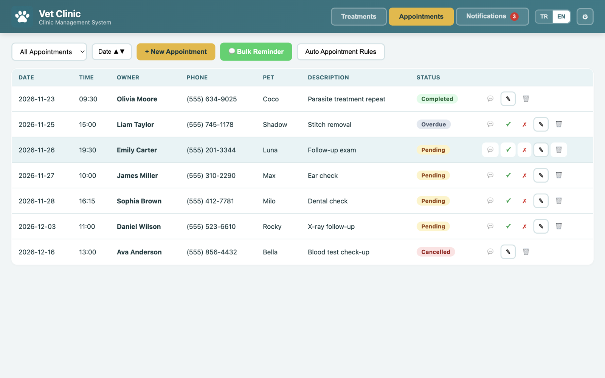 |
| **New treatment (auto appointment on)** | **Auto appointment rules** |
| 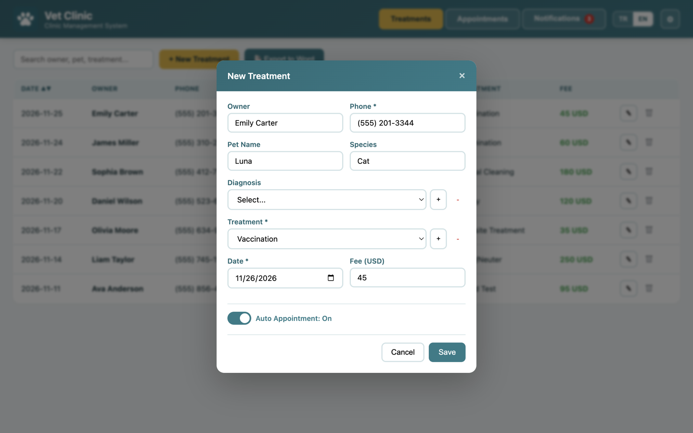 | 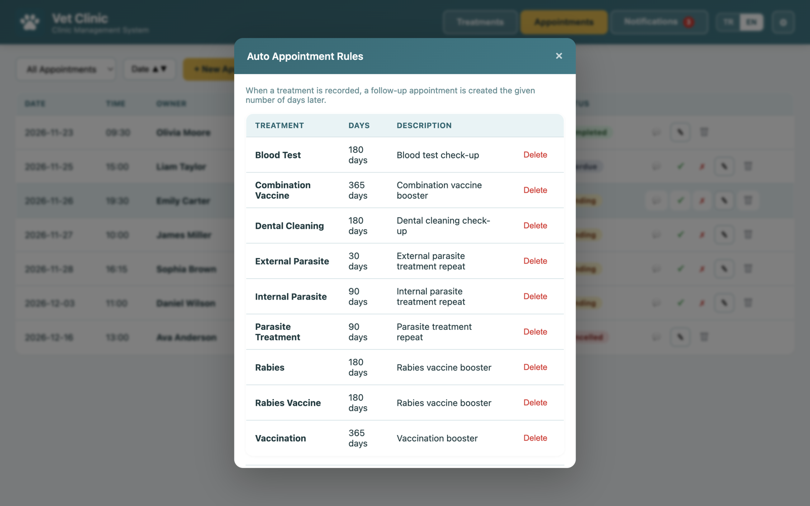 |
| **Notifications** | **Settings** |
| 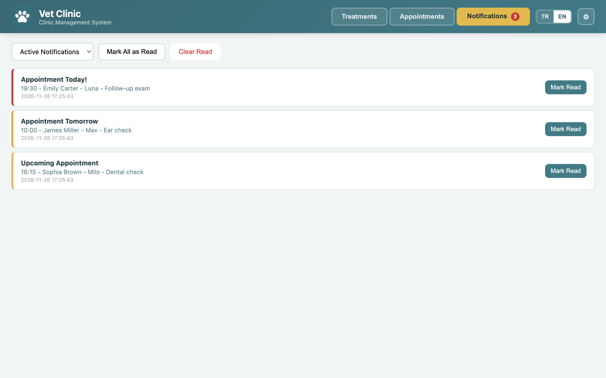 | 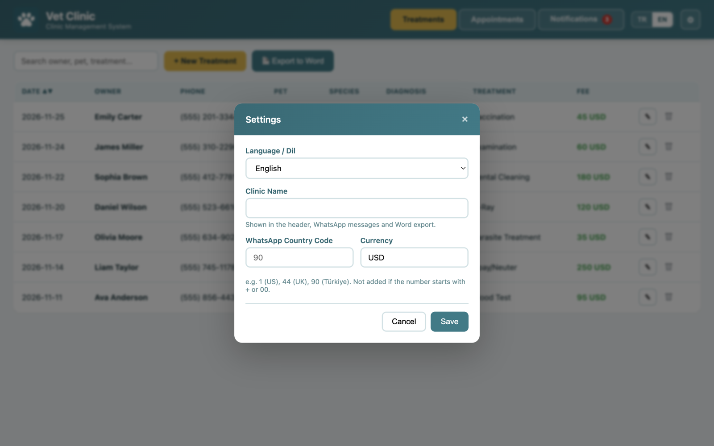 |

### How it works

**Auto appointments.** Every rule has a treatment name, a number of days and a description. When a treatment is saved with the *Auto Appointment* switch on, its name is checked against the rules (case-insensitive, partial match). On a match, an appointment is created at 09:00, *N* days after the treatment date. For example, a *Vaccination* on 1 March creates a *Vaccination booster* appointment one year later.

**Notifications.** On launch, and every 5 minutes after that, the app scans pending appointments from today to 3 days ahead and creates one notification per appointment per day. You can dismiss them from the top panel or manage them on the *Notifications* tab.

**WhatsApp.** Clicking the 💬 button opens WhatsApp Web with the message already typed in. Phone numbers are cleaned automatically:
- numbers starting with `+` are used as they are,
- numbers starting with `00` lose the `00`,
- otherwise leading zeros are removed and the country code from Settings is added (e.g. `0532 111 22 33` → `905321112233`).

**First launch.** The language follows the operating system: a Turkish system starts in Turkish (TL, country code 90), any other system in English (USD, no country code). The default treatment types, diagnoses and rules are created in that language only once, so items you delete stay deleted.

### Settings

| Setting | Used for |
|---|---|
| Language | Whole interface, WhatsApp messages, Word export |
| Clinic name | Window title and header, WhatsApp message intro, Word export title and file name |
| WhatsApp country code | Added to local phone numbers |
| Currency | Fee column, fee field label, Word export |

### Getting started

Requires [Node.js](https://nodejs.org) 18 or newer.

```bash
git clone https://github.com/omerzelka/VetClinic.git
cd VetClinic
npm install
npm start
```

### Building

```bash
npm run build        # Windows portable .exe  → dist/
npm run build:mac    # macOS .dmg             → dist/
./build.sh --help    # more Windows targets: --nsis, --msi, --zip, --all, --arch ia32|arm64
```

### Where is my data?

| Mode | Database location |
|---|---|
| Windows portable `.exe` | `veteriner.db` next to the `.exe` (copy the folder to move or back up everything) |
| Installed / `npm start` | `veteriner.db` in the app's user-data folder (`%APPDATA%\VetClinic` on Windows, `~/Library/Application Support/VetClinic` on macOS) |

To back up, copy `veteriner.db` while the app is closed.

### Project structure

```
main.js       Electron main process: SQLite database, IPC handlers, Word export, WhatsApp
preload.js    Safe bridge (contextBridge) exposing window.api to the UI
renderer.js   UI logic: tables, forms, modals, notifications, language switching
i18n.js       TR / EN dictionary and per-language default data (shared by main and UI)
index.html    Single-page layout (3 tabs + modals)
styles.css    Styles
build.sh      Windows cross-build helper for macOS
```

**Tech:** Electron · sql.js (SQLite compiled to WebAssembly) · docx · vanilla HTML / CSS / JS. The UI runs with `contextIsolation` on and `nodeIntegration` off, and every database call goes through IPC.

---

## Türkçe

VetClinic, küçük veteriner klinikleri için hafif ve çevrimdışı çalışan bir masaüstü uygulamasıdır. İşlem kayıtlarını tutar, randevuları yönetir, kontrol randevularını (aşı tekrarı, parazit tedavisi, kontrol muayenesi…) otomatik oluşturur, yaklaşan randevuları hatırlatır ve hasta sahiplerine WhatsApp üzerinden hatırlatma mesajı gönderir. Tüm veriler bilgisayarda tek bir SQLite dosyasında saklanır. Hesap ya da internet bağlantısı gerekmez (WhatsApp hariç).

Uygulama belirli bir kliniğe özel değildir: klinik adı, para birimi ve telefon ülke kodu **Ayarlar**'dan girilir. Arayüz tek tıkla **Türkçe ve İngilizce** arasında değiştirilebilir.

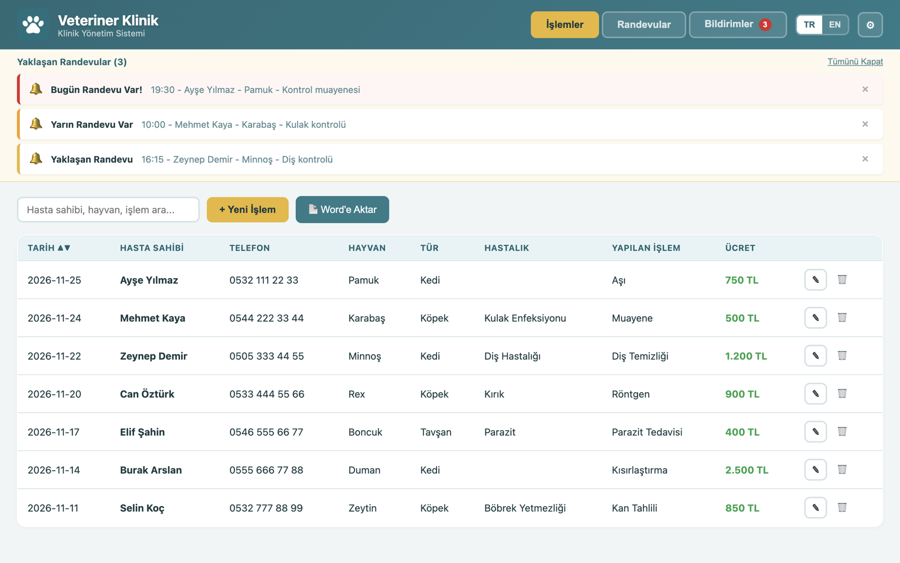

### Özellikler

| | |
|---|---|
| **İşlem kayıtları** | Hasta sahibi, telefon, hayvan, tür, hastalık, yapılan işlem, tarih ve ücret. Tüm alanlarda arama, tarihe göre sıralama, hasta sahibi otomatik tamamlama (telefon kendiliğinden dolar). |
| **Düzenlenebilir listeler** | İşlem türleri ve hastalıklar açılır listedir; **+ / −** düğmeleriyle ekleyip çıkarabilirsiniz. |
| **Randevular** | Bekliyor, tamamlandı, iptal ve geçmiş durumları. Tek tıkla tamamlama veya iptal, filtreleme ve tarihe göre sıralama. |
| **Otomatik randevu kuralları** | Yapılan işlem bir kurala uyuyorsa (ör. *Kuduz Aşısı → 180 gün*) kontrol randevusu kendiliğinden oluşturulur. İşlem formundaki anahtarla açılıp kapatılır. |
| **Bildirimler** | Açılışta bugün, yarın ve sonraki 3 gün içindeki randevular üstte renkli olarak gösterilir (kırmızı / turuncu / sarı). Ayrıca bildirim geçmişi sayfası vardır. |
| **WhatsApp hatırlatma** | Tek bir hasta sahibine ya da bugün ve yarın randevusu olan herkese tek seferde (**Toplu Hatırlatma**) hazır mesaj gönderilir. |
| **Word'e aktarma** | Tüm kayıtlar yatay bir `.docx` tablosu olarak dışa aktarılır. |
| **İki dil** | Üst çubukta TR / EN anahtarı vardır. Tablolar, pencereler, WhatsApp mesajları ve Word çıktısı seçilen dile göre değişir. |

### Ekran Görüntüleri

| İşlemler | Randevular |
|---|---|
|  | 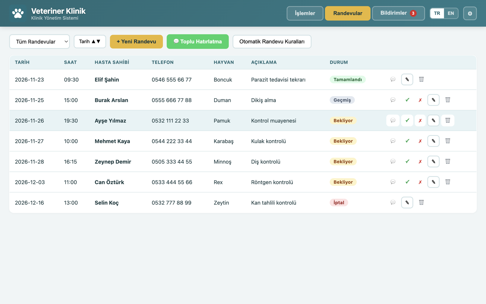 |
| **Yeni işlem (otomatik randevu açık)** | **Otomatik randevu kuralları** |
| 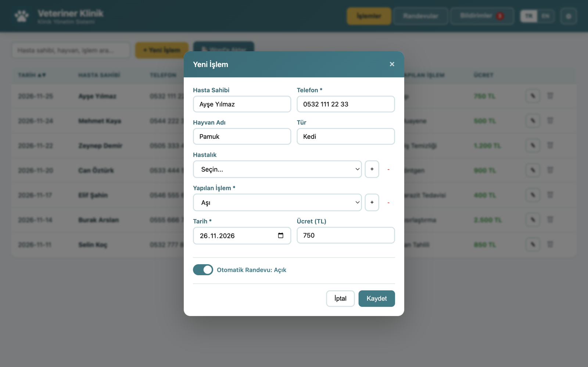 | 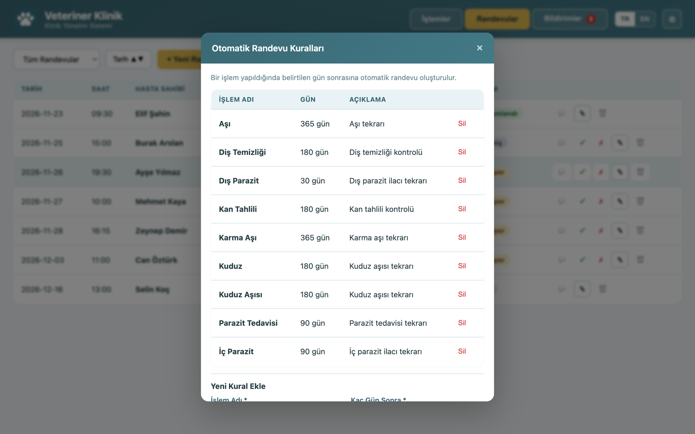 |
| **Bildirimler** | **Ayarlar** |
| 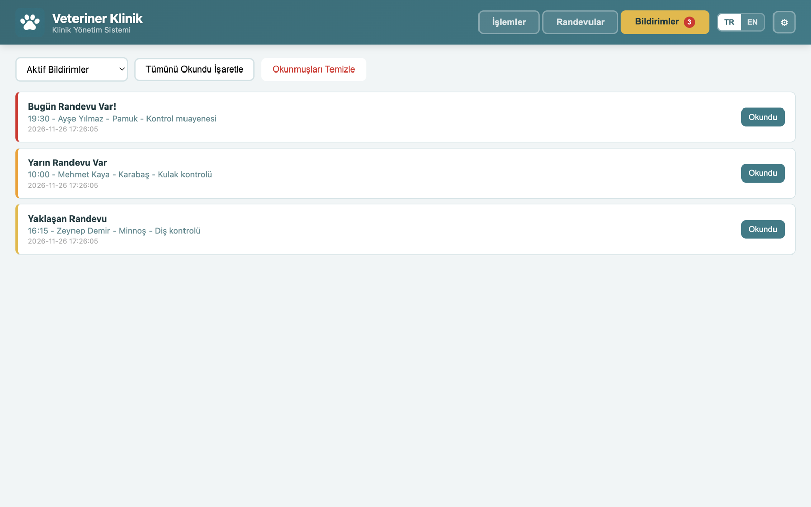 | 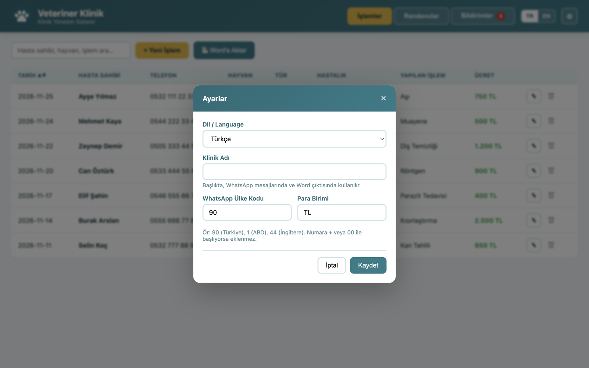 |

### Nasıl Çalışır?

**Otomatik randevu.** Her kuralın bir işlem adı, gün sayısı ve açıklaması vardır. *Otomatik Randevu* anahtarı açıkken bir işlem kaydedildiğinde, işlem adı kurallarla karşılaştırılır (büyük/küçük harf duyarsız, kısmi eşleşme). Eşleşme varsa işlem tarihinden *N* gün sonrasına, saat 09:00'a randevu oluşturulur. Örneğin 1 Mart'ta yapılan *Aşı* için bir yıl sonrasına *Aşı tekrarı* randevusu açılır.

**Bildirimler.** Uygulama açılışta ve sonra her 5 dakikada bir, bugünden 3 gün sonrasına kadar bekleyen randevuları tarar ve her randevu için günde bir bildirim oluşturur. Bildirimleri üstteki panelden kapatabilir ya da *Bildirimler* sekmesinden yönetebilirsiniz.

**WhatsApp.** 💬 düğmesi WhatsApp Web'i mesaj yazılmış olarak açar. Telefon numarası otomatik düzeltilir:
- `+` ile başlayan numara olduğu gibi kullanılır,
- `00` ile başlayan numaranın başındaki `00` atılır,
- diğerlerinde baştaki sıfırlar silinir ve Ayarlar'daki ülke kodu eklenir (ör. `0532 111 22 33` → `905321112233`).

**İlk açılış.** Dil işletim sistemine göre seçilir: Türkçe sistemde Türkçe (TL, ülke kodu 90), diğer sistemlerde İngilizce (USD, ülke kodu yok) başlar. Varsayılan işlem türleri, hastalıklar ve kurallar o dilde yalnızca bir kez oluşturulur; sildikleriniz geri gelmez.

### Ayarlar

| Ayar | Nerede kullanılır |
|---|---|
| Dil | Tüm arayüz, WhatsApp mesajları, Word çıktısı |
| Klinik adı | Pencere başlığı ve üst çubuk, WhatsApp mesajı girişi, Word çıktısının başlığı ve dosya adı |
| WhatsApp ülke kodu | Yerel numaralara eklenir |
| Para birimi | Ücret sütunu, ücret alanı etiketi, Word çıktısı |

### Kurulum

[Node.js](https://nodejs.org) 18 veya üstü gerekir.

```bash
git clone https://github.com/omerzelka/VetClinic.git
cd VetClinic
npm install
npm start
```

### Derleme

```bash
npm run build        # Windows taşınabilir .exe  → dist/
npm run build:mac    # macOS .dmg                → dist/
./build.sh --help    # diğer Windows hedefleri: --nsis, --msi, --zip, --all, --arch ia32|arm64
```

### Verilerim nerede?

| Çalışma şekli | Veritabanı konumu |
|---|---|
| Windows taşınabilir `.exe` | `.exe`'nin yanındaki `veteriner.db` (klasörü kopyalayarak her şeyi taşıyabilir veya yedekleyebilirsiniz) |
| Kurulu / `npm start` | Uygulamanın kullanıcı veri klasöründeki `veteriner.db` (Windows'ta `%APPDATA%\VetClinic`, macOS'ta `~/Library/Application Support/VetClinic`) |

Yedek almak için uygulama kapalıyken `veteriner.db` dosyasını kopyalayın.

### Proje Yapısı

```
main.js       Electron ana süreci: SQLite veritabanı, IPC, Word çıktısı, WhatsApp
preload.js    Arayüze window.api'yi güvenli şekilde açan köprü (contextBridge)
renderer.js   Arayüz mantığı: tablolar, formlar, pencereler, bildirimler, dil değişimi
i18n.js       TR / EN sözlük ve dile göre varsayılan veriler (ana süreç ve arayüz ortak)
index.html    Tek sayfalık düzen (3 sekme + pencereler)
styles.css    Stiller
build.sh      macOS'tan Windows derlemesi için yardımcı betik
```

**Teknolojiler:** Electron · sql.js (WebAssembly'ye derlenmiş SQLite) · docx · saf HTML / CSS / JS. Arayüz `contextIsolation` açık, `nodeIntegration` kapalı çalışır; veritabanına her erişim IPC üzerinden yapılır.

---

<sub>Screenshots use fictional demo data. · Ekran görüntülerindeki veriler kurgusaldır.</sub>
